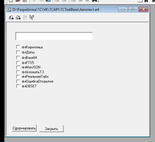

# 1cmcp — MCP-сервер внутри 1С:Предприятие 7.7

Внешняя компонента для 1cv7.exe: поднимает HTTP-сервер по протоколу [MCP](https://modelcontextprotocol.io),
через который ИИ-агент (Claude Code и другие) работает с запущенным сеансом 1С — как пользователь:
видит открытые формы, нажимает кнопки, вводит значения, читает таблицы и метаданные, выполняет код 1С.
Действия агента подсвечиваются на экране.



Одна `1cmcp.dll`, без зависимостей. Готовые файлы — в [релизах](https://github.com/alyuev/1cv7_mcp/releases).

## Установка

1. Положить `1cmcp.dll` (и `1cmcp.als` для синтакс-помощника) в каталог `BIN` или в каталог базы.
2. В глобальном модуле: `ЗагрузитьВнешнююКомпоненту(КаталогИБ() + "1cmcp.dll");`
3. **Сервис → Параметры → «MCP-сервер»**: сгенерировать токен, включить «Запускать сервер при загрузке»,
   нажать «Копировать команду для Claude Code» и выполнить её:

```bash
claude mcp add --transport http 1c http://127.0.0.1:8777/mcp --header "Authorization: Bearer <токен>"
```

## Что умеет

| | |
|---|---|
| Формы | `forms`, `form_controls`, `press_button`, `set_value`, `call_form_procedure`, `read_table` |
| Меню и интерфейс | `ui_find`, `show_menu`, `system_command`, `highlight`, `caption` |
| Данные | `metadata`, `object_id`, `open_object` |
| Код | `eval`, `run_code`, `read_messages`, `read_log` |
| Состояние | `status`, `screen`, `dialog_button`, `get_task` |

Агент может быть и подсказчиком по программе («где открывается Табло?» — покажет пункт меню и кнопку),
а режим демонстрации (`prompt demo`) показывает возможности на экране.

## Безопасность

- слушает только `127.0.0.1`; токен обязателен всегда;
- `РазрешитьКод=0` отключает всё, что меняет состояние (код, кнопки, команды);
- каждый вызов пишется в журнал (`SYSLOG\1cmcp.log`: время, пользователь, сеанс, параметры).

## Подробнее

Методы объекта `MCPСервер`, все инструменты и параметры, журнал и окно действий, сборка (VC6) и тесты —
в [docs/details.md](docs/details.md).
